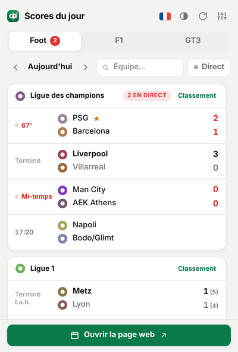
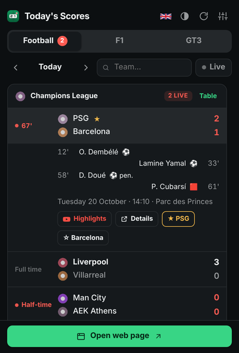
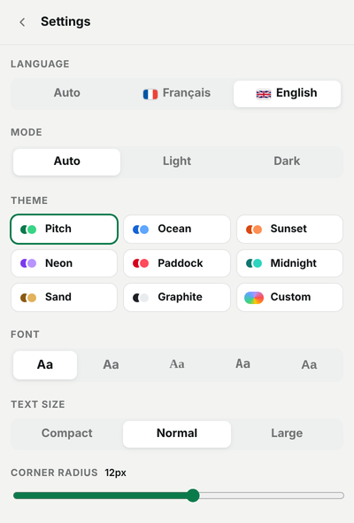
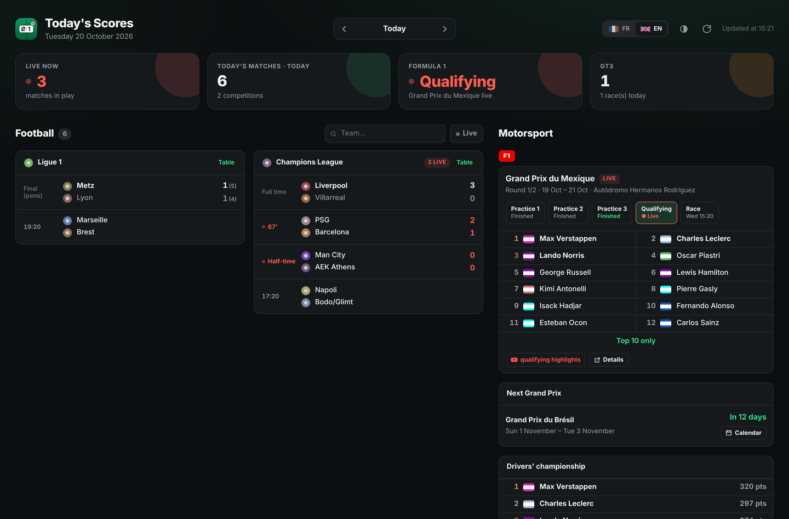
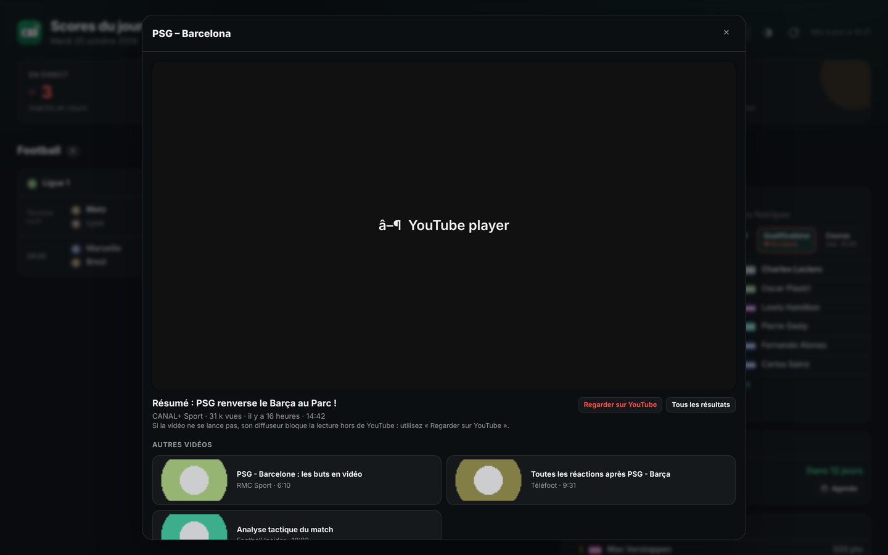
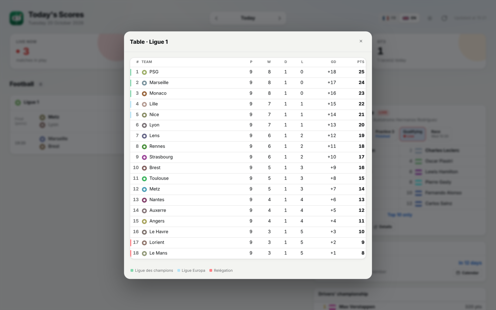

# Today's Scores (Scores du jour)

A Chrome extension that shows today's results in one click: live football, Formula 1 and GT3. Click the toolbar icon for a compact popup, or hit **Open web page** for a full-screen dashboard with inline video highlights. Everything runs locally inside the extension: no server, no account.

Available in **English** and **French** (follows Chrome's language, or switch with the flag).

<p align="center">
  
  
  
</p>

<p align="center">
  
</p>

<p align="center">
  
  
</p>

<sub>Screenshots taken with demo data.</sub>

## Features

**Football**
- Live, finished and upcoming matches for Ligue 1, Ligue 2, Coupe de France, Champions League, Europa League, Conference League, Premier League, LaLiga, Serie A, Bundesliga (more can be enabled)
- Match minute, half-time, extra time, penalty shoot-outs
- Click a match for scorers, penalties, red cards and venue
- Browse other days, search for a team, "Live only" filter
- League tables with qualification and relegation zones
- Favourite teams are highlighted (★) and can be followed from any match

**Formula 1**
- Current (or last) Grand Prix weekend with every session
- Classification for each session (practice, qualifying, sprint, race), live during the session
- Next Grand Prix with a countdown
- Drivers' championship

**GT3**
- Race of the day, last and next event (GT World Challenge Europe, British GT, or any TheSportsDB championship by ID)

**Full-screen page** ("Open web page" button, or <kbd>W</kbd> in the popup)
- Football, F1 and GT3 side by side, with live / today / F1 / GT3 summary tiles
- **Inline highlights**: the Highlights button plays the first YouTube result for the match right in the page, with the next results as alternatives
- League tables in a dialog, responsive down to phone width
- Stays in sync with the popup settings (theme, language, competitions, favourites)

**Everywhere**
- Highlights button for every finished match, F1 session and GT3 race
- Add a match or a Grand Prix to Google Calendar
- **Notifications** for kick-off, goals and full time (favourites only, all matches, or off)
- **Badge** on the toolbar icon with the number of live events
- Auto-refresh every 30 s while something is live

## Themes

- **Auto / Light / Dark** mode
- 8 palettes: Pitch, Ocean, Sunset, Neon, Paddock, Midnight, Sand, Graphite
- **Custom theme**: background, card, text, accent and live colours; font (5 styles), text size, corner radius
- Share a theme: "Copy theme code", then "Import" on another browser

## Keyboard shortcuts

| Key | Popup | Page |
|---|---|---|
| `1` `2` `3` | Football / F1 / GT3 tab | — |
| `←` `→` | Previous / next day | Previous / next day |
| `/` | Search for a team | Search for a team |
| `R` | Refresh | Refresh |
| `T` | Cycle light / dark mode | Cycle light / dark mode |
| `L` | Switch language | Switch language |
| `W` | Open the web page | — |
| `Esc` | Close a panel | Close a dialog |

## Installation

1. Download the repository (**Code → Download ZIP**) and unzip it, or clone it:
   ```
   git clone https://github.com/Dyslate/result_of_sports.git
   ```
2. Open `chrome://extensions` in Chrome.
3. Turn on **Developer mode** (top right).
4. Click **Load unpacked** and select the `result_of_sports` folder.
5. Pin the extension (puzzle icon → pin) and click it.

Requires Chrome 123 or later.

## Data sources

| Sport | Source | Content |
|---|---|---|
| Football | ESPN public API (`site.api.espn.com`) | scores, scorers, tables |
| Formula 1 | ESPN public API | sessions, classifications, championship |
| GT3 | [TheSportsDB](https://www.thesportsdb.com) (free key) | calendar |
| Highlights | YouTube search results page | first videos for a search |

None of these require an API key, but they are not officially documented and may change. No free source publishes live GT3 race results, so the GT3 section is limited to the calendar.

Inline highlights rely on YouTube embeds: some broadcasters disable embedding on their videos, in which case the player shows a message and the **Watch on YouTube** button opens the video directly. If you have never accepted YouTube's cookie banner in Chrome, the search may be blocked by the consent page; open youtube.com once to accept it.

## Project structure

```
manifest.json          Manifest V3 (name and description localised via _locales/)
popup.html / popup.js  Toolbar popup
page.html / page.js    Full-screen dashboard
page.css               Dashboard layout
app.css                Shared theme and components
theme-init.js          Applies the theme before first paint
background.js          Service worker: badge and notifications
src/api.js             API calls and data normalisation
src/render.js          Shared HTML rendering (popup + page)
src/i18n.js            English / French strings
src/config.js          Competitions, palettes and default settings
icons/                 Extension icons
docs/                  README screenshots
```

## License

MIT
