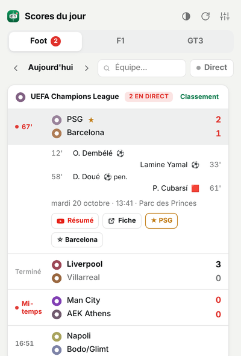
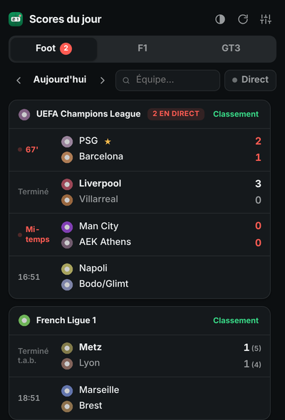
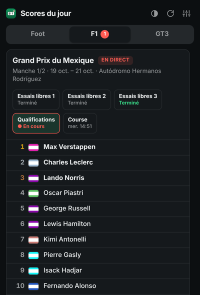
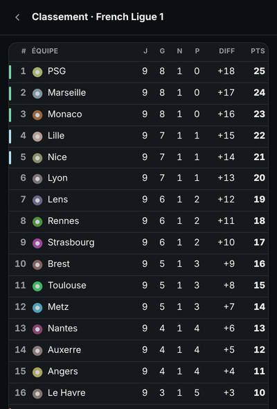
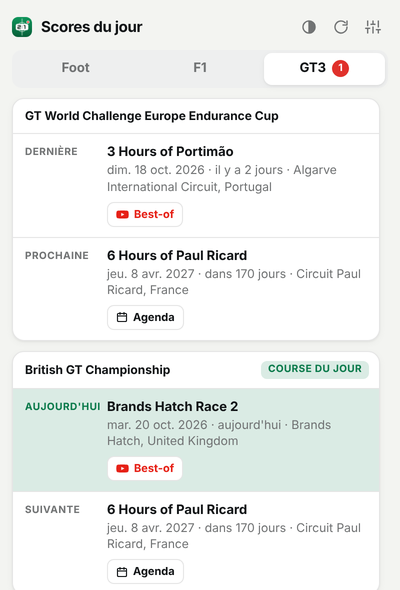
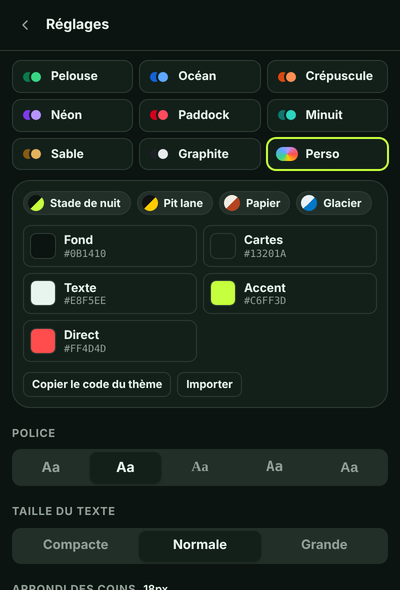

# Scores du jour

Extension Chrome qui affiche les résultats du jour en un clic sur son icône : football en direct, Formule 1 et GT3. Tout tourne en local dans le popup de l'extension ; aucun serveur, aucun compte.

<p align="center">
  
  
  
</p>
<p align="center">
  
  
  
</p>

<sub>Captures réalisées avec des données de démonstration.</sub>

## Fonctionnalités

**Football**
- Scores en direct, terminés et à venir pour Ligue 1, Ligue 2, Coupe de France, Ligue des champions, Ligue Europa, Ligue Conférence, Premier League, LaLiga, Serie A, Bundesliga (et d'autres à activer)
- Minute de jeu, mi-temps, prolongations, tirs au but
- Détail d'un match au clic : buteurs, penalties, cartons rouges, stade
- Navigation par jour (hier, demain…), recherche d'équipe, filtre « Direct »
- Classement de chaque compétition, avec zones de qualification et de relégation
- Équipes favorites mises en avant (★), à suivre d'un clic depuis un match

**Formule 1**
- Week-end en cours ou dernier Grand Prix, avec toutes les séances
- Classement de chaque séance (essais, qualifs, sprint, course), en direct pendant la séance
- Prochain Grand Prix avec compte à rebours
- Championnat pilotes

**GT3**
- Course du jour, dernière et prochaine épreuve (GT World Challenge Europe, British GT, ou n'importe quel championnat TheSportsDB via son identifiant)

**Partout**
- Bouton **Résumé / Best-of** qui ouvre les vidéos YouTube du match, de la séance ou de la course
- Bouton **Agenda** pour ajouter un match ou un Grand Prix à Google Agenda
- **Notifications** de coup d'envoi, de but et de fin de match pour vos favoris (ou tous les matchs)
- **Badge** sur l'icône avec le nombre d'événements en direct
- Actualisation automatique toutes les 30 s quand il y a du direct

## Thèmes

- Mode **Auto / Jour / Nuit**
- 8 palettes : Pelouse, Océan, Crépuscule, Néon, Paddock, Minuit, Sable, Graphite
- **Thème personnalisé** : couleurs du fond, des cartes, du texte, de l'accent et du direct ; police (5 styles), taille du texte, arrondi des coins
- Partage de thème : « Copier le code du thème » puis « Importer » sur un autre navigateur

## Raccourcis clavier

| Touche | Action |
|---|---|
| `1` `2` `3` | Onglets Foot / F1 / GT3 |
| `←` `→` | Jour précédent / suivant |
| `/` | Rechercher une équipe |
| `R` | Actualiser |
| `T` | Changer de mode jour/nuit |
| `Échap` | Fermer un panneau |

## Installation

1. Téléchargez le dépôt (bouton **Code → Download ZIP**) et décompressez-le, ou clonez-le :
   ```
   git clone https://github.com/Dyslate/scores-du-jour.git
   ```
2. Ouvrez `chrome://extensions` dans Chrome.
3. Activez le **Mode développeur** (en haut à droite).
4. Cliquez sur **Charger l'extension non empaquetée** et choisissez le dossier `scores-du-jour`.
5. Épinglez l'extension (icône puzzle → punaise) puis cliquez dessus.

Chrome 123 ou plus récent est nécessaire.

## Sources de données

| Sport | Source | Contenu |
|---|---|---|
| Football | API publique ESPN (`site.api.espn.com`) | scores, buteurs, classements |
| Formule 1 | API publique ESPN | séances, classements, championnat |
| GT3 | [TheSportsDB](https://www.thesportsdb.com) (clé gratuite) | calendrier |

Ces API ne demandent pas de clé, mais elles ne sont pas officiellement documentées et peuvent évoluer. Aucune source gratuite ne publie les classements de course GT3 en direct ; l'onglet GT3 se limite donc au calendrier.

## Structure

```
manifest.json      Manifest V3
popup.html/.css/.js  Interface du popup
theme-init.js      Application du thème avant le premier rendu
background.js      Service worker : badge et notifications
src/api.js         Appels aux API et normalisation des données
src/config.js      Compétitions, palettes et réglages par défaut
icons/             Icônes de l'extension
```

## Licence

MIT
